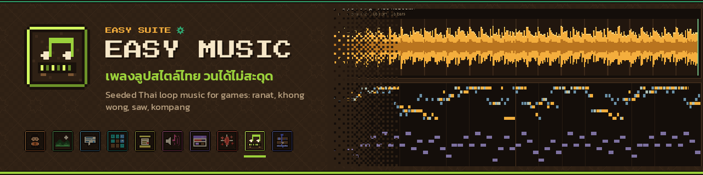
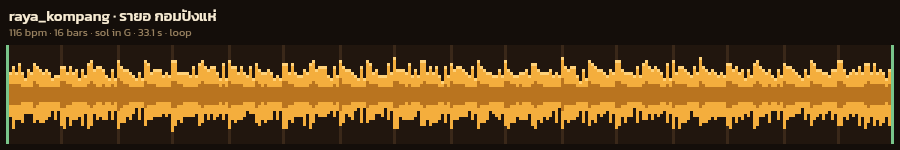
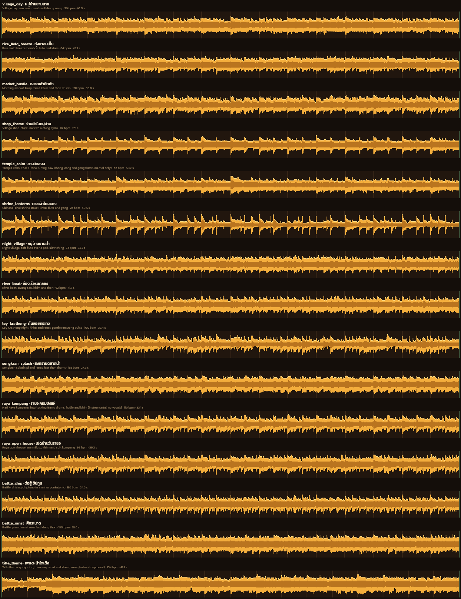
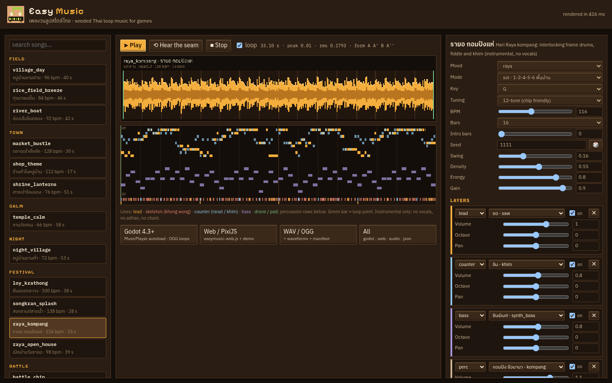

<!-- easy-suite:header:start -->
<p align="center">
  <a href="#easy-suite"></a>
</p>

<p align="center">
  <b>Easy Music</b> · เพลงลูปสไตล์ไทย วนได้ไม่สะดุด · Seeded Thai loop music for games<br />
  <sub>Part of <a href="#easy-suite"><b>Easy Suite</b></a>: Thai-friendly pixel-art game dev tools for Godot 4.3+ and PixiJS v8</sub>
</p>

<p align="center">
  <a href="https://github.com/Saladin2020/easymusic/actions/workflows/ci.yml"></a> <a href="LICENSE"></a>  <a href="#export"></a> <a href="docs/MCP.md"></a> 
</p>

<p align="center">
  <a href="https://github.com/Saladin2020/easysprite"></a>
  <a href="https://github.com/Saladin2020/easyscene"></a>
  <a href="https://github.com/Saladin2020/easydialogue"></a>
  <a href="https://github.com/Saladin2020/easytilemap"></a>
  <a href="https://github.com/Saladin2020/easyquest"></a>
  <a href="https://github.com/Saladin2020/easysfx"></a>
  <a href="https://github.com/Saladin2020/easyui"></a>
  <a href="https://github.com/Saladin2020/easyfx"></a>
  <a href="https://github.com/Saladin2020/easymusic"></a>
  <a href="https://github.com/Saladin2020/easyanim"></a>
</p>
<!-- easy-suite:header:end -->

# Easy Music

**เพลงประกอบเกมสไตล์ไทย วนลูปได้ไม่สะดุด · ระนาด ฆ้องวง ซอ ขิม ปี่ ฉิ่งฉาบ กลองทน กอมปัง**  
Describe a loop as a mood, a Thai pentatonic mode, a tempo, a seed and a few instrument layers in a small JSON
format, hear it in a web editor, and export **stereo WAV / OGG with loop points**, a **Godot 4.3+** project
(OGG streams with `loop_offset` and a `MusicPlayer` autoload that cross-fades), or a **web / PixiJS** player with
the same loop points. 15 built-in presets for a multicultural southern Thai village: fields, market, shop, temple
and shrine, night, river, Loy Krathong, Songkran, Hari Raya, battles and a title theme. Built on the synth approach
of [Easy SFX](https://github.com/Saladin2020/easysfx).

[](https://nodejs.org)

> Easy Music **composes · synthesizes · exports**. Every sample comes from a seeded composer and code synths (CC0):
> no recordings, no sample packs, no AI generation, no paid APIs. The same seed gives the same file byte for byte
> in the CLI, the editor, Godot and the web. Loops are rendered on a circular buffer, so release tails wrap
> round to the start and the seam has no click and no gap. **Instrumental only:** there is no voice, and Easy
> Music never synthesizes the adhan, Quran recitation or any religious chant.

<p align="center">
  
</p>

---

## What you get

| Presets (15) | Instruments | Export |
| --- | --- | --- |
| **field** village_day, rice_field_breeze, river_boat · **town** market_bustle, shop_theme, shrine_lanterns · **calm** temple_calm · **night** night_village · **festival** loy_krathong, songkran_splash, raya_kompang, raya_open_house · **battle** battle_chip, battle_ranat · **menu** title_theme (intro + loop point) | **Thai** ranat (ระนาดเอก, mallet + kro tremolo), khong wong (ฆ้องวง, beating gong-circle), saw (ซอ, bowed), khim (ขิม, hammered strings), pi (ปี่, reed), flute (ขลุ่ย) · **percussion** ching/chap cycle (ฉิ่งฉาบ), klong thon (กลองทน), kompang interlock (กอมปัง), gong (โหม่ง) · **chip** square, pulse, triangle, drums · synth pad and bass | Godot 4.3+ (`easymusic/music/*.ogg` with loop offsets, `music.json`, `MusicPlayer` autoload, demo + `test_music.gd`), web / PixiJS (`easymusic-web.js` Web Audio player, `index.html` demo, manifest with a `@pixi/sound` bundle), stereo WAV (`smpl` loop chunk) + OGG (`LOOPSTART`/`LOOPLENGTH`) + waveform PNGs, resolved JSON with the score |

<p align="center">
  
</p>

**How it sounds Thai · ทำไมฟังเป็นไทย**: melodies use the five rotations of the anhemitonic pentatonic
(`do re mi sol la` modes, the five-note scale of Thai classical and folk tunes). The composer writes a lead in
A A′ B A″ phrases that cadence on the tonic, a **khong wong skeleton** on the beat (the "main melody" of a
piphat ensemble), **heterophonic** ranat/khim runs that decorate it, and the **ching** marking the cycle (open
*ching* / closed *chap*) with the gong on phrase starts. `tuning: "thai7"` switches to Thai 7-tone equal
temperament (~171 cents a step) for a more traditional colour; the default `equal12` blends with chiptune.

**Festivals of the village · เทศกาลในหมู่บ้าน**: Loy Krathong (gentle ramwong pulse), Songkran (fast thon drums,
pi), the Chinese-Thai shrine street (khim, flute, gong), and for **Hari Raya** (รายอ) interlocking kompang frame
drums with fiddle and khim, plus a softer open-house tune. All are instrumental: no vocals, no adhan, no
recitation, no chant. `temple_calm` is calm ambience for the temple grounds, not ritual music.

## Quick start

```bash
npm install
npm run build
npx easymusic init                      # songs/ exports/ + 3 sample workspace songs
npx easymusic list                      # 15 presets + workspace songs
npx easymusic render village_day --out village.ogg
npx easymusic render title_theme --out title.mp3 --loops 2 --fade 3   # linear preview
npx easymusic serve --open              # web editor → http://127.0.0.1:8858
npx easymusic export                    # exports/easymusic-{godot,web,audio,json}
```

`EASYMUSIC_HOME` (or `EASYMUSIC_WORKSPACE`, or `--workspace`) picks the workspace; otherwise the current folder.
OGG and MP3 need `ffmpeg` on `PATH` (or `EASYMUSIC_FFMPEG`); WAV needs nothing.

<p align="center">
  
</p>

The editor renders in the browser with the same code as the CLI, plays the loop, and has **Hear the seam**
(starts two seconds before the loop end so you can listen for a click). It shows the waveform and a piano roll
(lead, khong wong skeleton, counter, bass, drone and percussion rows) with a playhead and the loop point, and lets
you edit mood, mode, key, tuning, tempo, bars, intro, seed, swing, density and energy, plus each layer.
Save writes `songs/<id>.easymusic.json`; the export buttons run the same exporters as the CLI.

## CLI

| Command | What it does |
| --- | --- |
| `init` | create `songs/` and `exports/` with three sample songs |
| `info` · `list [--tag t] [--json]` | workspace summary · presets and workspace songs |
| `show <id>` | resolved params as JSON |
| `check <id or file>` | validate (JSON path + message); exit code 1 on errors |
| `render <id> [--out f.wav\|.ogg\|.mp3] [--loops n] [--fade s] [--seed n] [--set k=v …] [--waveform png]` | audio file (looping by default; `--loops` unrolls a linear preview) |
| `waveform <id> [--out png]` | waveform PNG |
| `new <id> --from <preset> [--set k=v …] [--th] [--en] [--force]` | write `songs/<id>.easymusic.json` |
| `export [ids…] [--preset godot\|web\|pixi\|audio\|json\|all] [--tag t] [--out dir] [--no-ogg]` | exports |
| `serve [--port 8858] [--dev] [--open]` | web editor + API |

`--set` paths: `bpm=110`, `mode=la`, `tuning=thai7`, `seed=7` (top level), `lead.instrument=pi` (first layer with
that role), `2.volume=0.6` (layer 2), `*.octave=1` (every layer).

## Song format

```json
{
  "format": "easymusic/1",
  "th": "ตลาดนัดกลางคืน", "en": "Night market (pasar malam)",
  "base": "market_bustle",
  "set": { "mode": "sol", "bpm": 118, "swing": 0.12, "seed": 4407, "lead.instrument": "khim" }
}
```

Start from a preset (`base` + `set`) or write full `params` (`mood`, `mode`, `key`, `tuning`, `bpm`, `bars`,
`introBars`, `seed`, `swing`, `density`, `energy`, `gain`, `layers[]`). Full reference: [docs/FORMAT.md](docs/FORMAT.md).

## Export

| Preset | Output (`exports/easymusic-<preset>/`) |
| --- | --- |
| `audio` | `music/<id>.wav` (stereo 16-bit, `smpl` loop chunk) + `music/<id>.ogg` (`LOOPSTART`/`LOOPLENGTH` comments), `waveforms/<id>.png`, `easymusic.json` manifest (loop points in seconds and samples) |
| `godot` | Godot 4.3+ project: `easymusic/music/<id>.ogg`, `easymusic/music.json`, `easymusic/music_player.gd` registered as the **`MusicPlayer`** autoload, `main.tscn` demo (one button per song), `test_music.gd` |
| `web` (alias `pixi`) | `music/*.ogg` + `.wav`, `easymusic-web.js` (`loadMusic(url)` → `play(id, {fade})`, `stop`, `preload`, `setVolume`, `position`, `ids`, `info`), `index.html` demo, manifest with a `pixiSound` bundle for `@pixi/sound` |
| `json` | resolved params + the composed score (notes per layer) |

Godot plays the OGG with `loop = true` and `loop_offset = loopStart`; a WAV gets `LOOP_FORWARD` with
`loop_begin`/`loop_end`. The player keeps two `AudioStreamPlayer`s and cross-fades between songs with a tween.

```gdscript
# Godot: MusicPlayer is an autoload in the exported project
MusicPlayer.play("village_day")          # cross-fades from whatever is playing
MusicPlayer.play("raya_kompang", 2.0)    # slower fade
MusicPlayer.stop(1.5)
```

```js
// Web / PixiJS v8 (Web Audio; works next to any Pixi app)
import { loadMusic } from "./easymusic-web.js";
const music = await loadMusic("easymusic.json");
await music.play("market_bustle");       // call after a user gesture (autoplay rules)
```

With `@pixi/sound`, add `manifest.pixiSound` as a bundle and set `loop: true`; note that `@pixi/sound` loops the
whole file, so songs with an intro (`title_theme`) should use `easymusic-web.js`, which honours `loopStart`.

## MCP

`npm run mcp` (stdio) or `npm run mcp:http` (→ `http://127.0.0.1:8859/mcp`). Tools: `workspace_info`,
`list_songs`, `get_song`, `write_song` (with `dryRun`), `render_song` (returns timing and a waveform image),
`export_music`. See [docs/MCP.md](docs/MCP.md).

## Security

Local-first: the API and MCP HTTP server bind to `127.0.0.1`; any other interface needs the bearer token printed at
startup (or `EASYMUSIC_TOKEN`), and browser requests must come from the editor's own origin. File paths stay inside
the workspace (plus `EASYMUSIC_ALLOWED_DIRS`). Song ids are `[a-z0-9_-]`. Nothing calls a network or paid API;
`ffmpeg` is the only external program and is only used for OGG/MP3.

## Development

```bash
npm run typecheck && npm test && npm run build && npm run smoke
GODOT=/path/to/godot npx vitest run test/godot.test.ts       # headless Godot import + test_music.gd
python3 scripts/check-web.py exports/easymusic-web            # web player in headless Chrome
npm run dev                                                   # API :8858 + Vite :5181
npm run docs:images                                           # waveforms in docs/assets
```

Golden hashes of every preset live in `test/golden.json` (`UPDATE_GOLDEN=1 npx vitest run test/render.test.ts`
after a deliberate change to the composer or synths).

## Easy Suite


Ten small, local-first tools that share one look (teak, lantern gold, Kanit, 16/48px pixels), one
workflow (CLI · web editor · MCP server) and the same targets (**Godot 4.3+** and **PixiJS v8**).
ชุดเครื่องมือทำเกมพิกเซลสไตล์ไทย ใช้ร่วมกันได้ทั้งชุด  
The samples share one multicultural southern Thai village: Buddhist temple, wooden kampung mosque and
Chinese-Thai shrine on the same street. หมู่บ้านพหุวัฒนธรรม วัด มัสยิด ศาลเจ้า อยู่ร่วมกันในเมืองเดียว

| | Tool | What it does | Repo |
|:-:|---|---|---|
|  | [**Easy Sprite**](https://github.com/Saladin2020/easysprite) | Compose modular 48px chibi characters (top-down + side-view) and export sheets. | [`easysprite`](https://github.com/Saladin2020/easysprite) |
|  | [**Easy Scene**](https://github.com/Saladin2020/easyscene) | Side-view levels: parallax layers, 16px autotiles, Thai town props. | [`easyscene`](https://github.com/Saladin2020/easyscene) |
|  | [**Easy Dialogue**](https://github.com/Saladin2020/easydialogue) | Branching `.ezd` dialogue with Thai-safe text, portraits and choices. | [`easydialogue`](https://github.com/Saladin2020/easydialogue) |
|  | [**Easy Tilemap**](https://github.com/Saladin2020/easytilemap) | Top-down 16px maps: blob-47 autotiles, objects, collision, spawns. | [`easytilemap`](https://github.com/Saladin2020/easytilemap) |
|  | [**Easy Quest**](https://github.com/Saladin2020/easyquest) | Text `.ezq` quests: steps, flags, items, rewards, linked to dialogue. | [`easyquest`](https://github.com/Saladin2020/easyquest) |
|  | [**Easy SFX**](https://github.com/Saladin2020/easysfx) | Deterministic 8-bit SFX and 4-channel chiptune loops, typing blips. | [`easysfx`](https://github.com/Saladin2020/easysfx) |
|  | [**Easy UI**](https://github.com/Saladin2020/easyui) | Nine-slice pixel UI kit: panels, bars, inventory, menus, 30 icons. | [`easyui`](https://github.com/Saladin2020/easyui) |
|  | [**Easy FX**](https://github.com/Saladin2020/easyfx) | Pixel particles: sparks, fire, rain, lanterns, Raya pelita; sheets + Godot particles. | [`easyfx`](https://github.com/Saladin2020/easyfx) |
|  | **Easy Music** ← you are here | Seeded Thai loop music: ranat, khong wong, saw, khim, pi, kompang; seamless WAV/OGG loops. | [`easymusic`](https://github.com/Saladin2020/easymusic) |
|  | [**Easy Anim**](https://github.com/Saladin2020/easyanim) | Cutscene timelines: actors, camera, dialogue, FX and music cues; Godot + Pixi runners. | [`easyanim`](https://github.com/Saladin2020/easyanim) |

### Works with

- **Easy SFX** makes the one-shot sounds (hits, coins, typing blips); Easy Music makes the long loops. Both are seeded and CC0.
- **Easy Anim** cutscenes cue songs by id (`music` / `music_stop` events); **Easy Quest** and **Easy Dialogue** can switch area themes on quest steps.
- One mood per **Easy Scene** / **Easy Tilemap** area: `village_day` in the kampung, `market_bustle` at the market, `shrine_lanterns` on the shrine street, `raya_open_house` at a Raya visit.
<!-- easy-suite:table:end -->

## Credits

All music is composed and synthesized from code and CC0. Kanit © The Kanit Project Authors (SIL OFL 1.1), used only
in the docs art and waveform images. See [CREDITS.md](CREDITS.md). Code: MIT © Salahuddin Benno.
